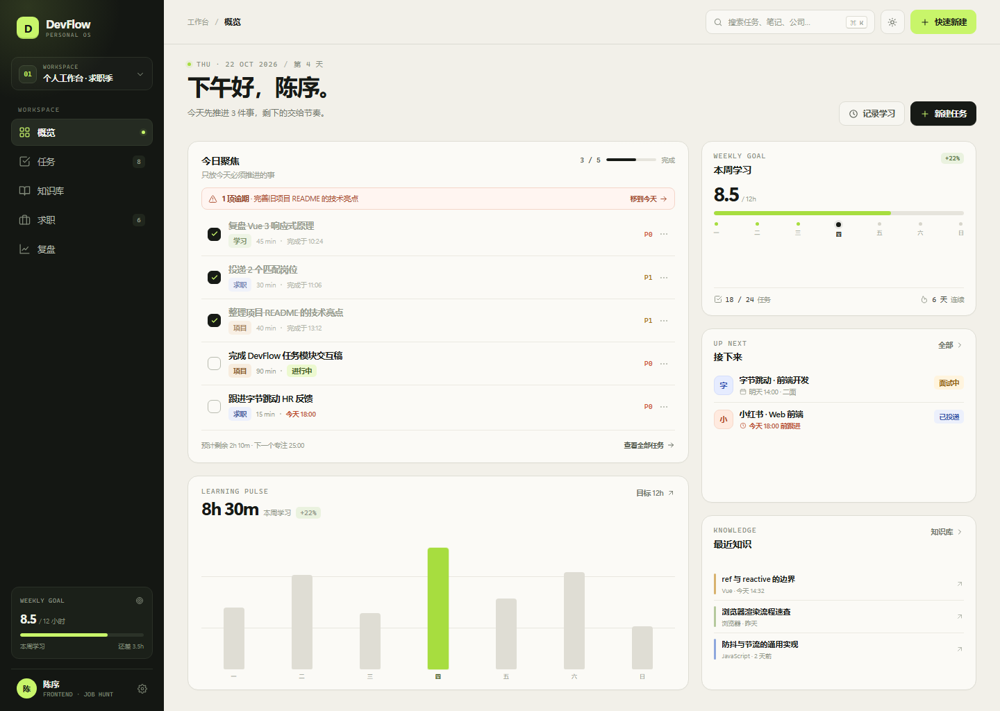
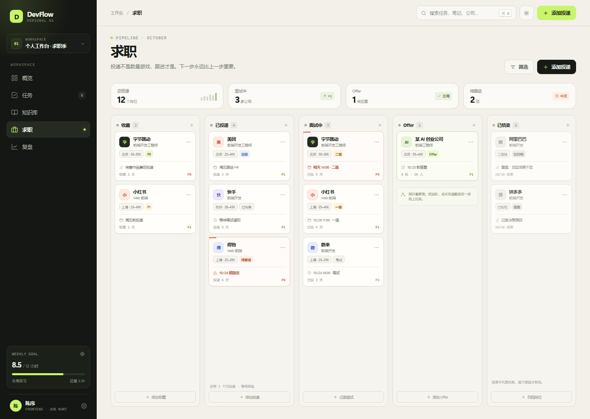

# DevFlow

个人工作台：把任务、知识库、投递、复盘和 AI 面试准备收在一个应用里。


> 界面来自 `design/exports` 的设计稿；实际运行时数据、AI 面板与性能卡片会有所不同。

| 概览 | 求职 |
| --- | --- |
|  |  |

## 功能

- **概览**：今日聚焦、逾期提醒、本周学习目标、下一步投递、最近知识
- **任务**：今天 / 本周 / 全部筛选，分组、快速添加、完成与撤销、编辑抽屉
- **知识库**：笔记 / 面试题 / 代码片段，Markdown 渲染、自动保存、搜索、类型与标签筛选
- **求职**：五阶段看板、拖拽与键盘「移动到阶段」、详情时间线、岗位要求、简历选择
- **简历库**：PDF / DOCX / TXT / MD 上传解析，批量导入，多个投递共用
- **AI 面试准备**：岗位匹配分析、3-3-2 模拟面试（基础 / 深挖 / 场景）、会话持久化
- **知识问答**：基于本地 RAG 检索，返回引用片段
- **复盘**：学习与投递 KPI、AI 用量（tokens、首字 P75、缓存命中）、Web 性能（LCP / CLS / FCP P75）
- **数据备份**：JSON 导出 / 导入，导入前确认与撤销

## 技术栈

| 层 | 技术 |
| --- | --- |
| 前端 | Vue 3.5（`<script setup>`）、TypeScript 6、Vite 8、vue-router 4、Pinia |
| UI | Reka UI（按需）、lucide-vue-next、原生 CSS + CSS 变量、ECharts |
| 服务端 | Node.js 22+、Express 5、better-sqlite3 |
| AI | DeepSeek（chat / reasoner）、mock provider、SSE 流式输出 |
| RAG | 文本切块、`@xenova/transformers` 多语言 embedding、余弦 TopK |
| 工程 | ESLint、Prettier、Husky、lint-staged、commitlint |

## 架构

```text
Browser (Vue 3 SPA)
  ├─ localStorage: 任务 / 知识 / 投递 / 简历 / 设置
  ├─ Web Worker: 批量简历解析
  ├─ fetch + SSE ──────────────┐
  └─ sendBeacon: Web Vitals    │
                               ▼
                      Express /api
                        ├─ /api/ai/chat ──> DeepSeek / mock，SSE 返回
                        ├─ /api/rag/* ────> 切块 + embedding ──> SQLite
                        ├─ /api/vitals ───> SQLite web_vitals
                        └─ /api/stats ────> metrics 聚合
```

核心业务数据保存在浏览器 `localStorage`；服务端只保存 RAG 切块、AI 调用指标、结果缓存和性能样本。

## 目录

```text
.
├─ devflow/          Vue 3 前端
├─ server/           Express + SQLite 服务端
├─ design/           设计物料（只读，不参与构建）
├─ .husky/           Git 提交钩子
├─ lint-staged.config.cjs
├─ commitlint.config.cjs
└─ package.json      根目录工程工具
```

## 快速开始

环境：Node.js >= 22、npm。

### 1. 启动服务端

```bash
cd server
npm install
cp .env.example .env      # PowerShell: Copy-Item .env.example .env
npm run dev               # http://localhost:3001
```

默认 `LLM_PROVIDER=mock`，不填 API Key 也能跑通流式链路。要使用真实模型，在 `server/.env` 中设置：

```env
LLM_PROVIDER=deepseek
DEEPSEEK_API_KEY=你的 Key
EMBEDDING_PROVIDER=transformers
```

`.env` 已在忽略列表中，不要提交。

### 2. 启动前端

```bash
cd devflow
npm install
npm run dev               # http://localhost:5173
```

Vite 会把 `/api` 代理到 `http://localhost:3001`。

## 常用命令

| 位置 | 命令 | 作用 |
| --- | --- | --- |
| 根目录 | `npm run prepare` | 安装 Husky 钩子 |
| devflow | `npm run dev` | 开发服务器 |
| devflow | `npm run typecheck` | `vue-tsc -b` |
| devflow | `npm run lint` | ESLint |
| devflow | `npm run format` | Prettier 写入 |
| devflow | `npm run build` | 类型检查 + 生产构建 |
| devflow | `npm run analyze` | 构建并输出 `dist/stats.html` |
| server | `npm run dev` | `tsx watch` |
| server | `npm run typecheck` | `tsc --noEmit` |
| server | `npm run build` | 输出 `dist/` |

## 实现要点

- **SSE**：客户端按 `\n\n` 缓冲切帧，支持 Abort、退避重试、首字延迟统计
- **RAG**：500 字切块、80 字重叠，embedding 失败回退哈希向量；检索结果带引用
- **模型路由**：按 `purpose` 选择 chat / reasoner，reasoner 自动忽略 `temperature`
- **结果缓存**：模型 + messages + 参数生成 key，命中直接回放并标记 `cached`
- **可观测性**：AI 调用写入 `metrics`，Web Vitals 通过 `sendBeacon` 上报，按 P50/P75/P95 聚合
- **前端性能**：路由懒加载、Rolldown vendor 分组、简历解析 Worker

## 数据与隐私

- 无账号、无云同步；任务、知识、投递、简历保存在浏览器本地
- 使用 AI 功能时，简历和岗位要求会发送到配置的模型服务
- DeepSeek Key 只存在于 `server/.env`，不会下发到浏览器
- 清除站点数据会清空本地数据，建议定期使用「导出」备份

## 状态

核心功能与 AI 模块已完成，本地可以完整运行。尚未接入：自动化测试、CI、线上部署。

## License

[MIT](LICENSE)
